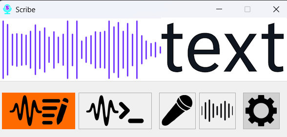

# Scribe

> A powerful, offline, real-time voice-to-text application for Windows.

Scribe is a versatile tool designed to integrate voice commands and transcription seamlessly into your workflow. Powered by the Vosk Offline Speech Recognition Toolkit, it ensures that all your data remains private by processing everything locally on your machine. Whether you need to dictate text, control applications with your voice, or automate repetitive tasks, Scribe provides a flexible and powerful solution.

## Key Features

*   **Real-Time Transcription:** Dictate text directly into any application with high accuracy.
*   **Punctuation and Capitalization:** Automatic `. , ? :` and `-`, plus capital letters, in every language covered by the model — 31 of the 32 Vosk catalog languages (all except Breton). One offline multilingual model, enabled by default.
*   **Command Mode:** Execute actions using custom voice commands.
*   **Offline and Private:** All voice processing happens locally on your machine. No data is ever sent to the cloud.
*   **Lightweight Performance:** Low CPU usage, especially when using small Vosk models, ensuring smooth operation without slowing down your system.
*   **Multi-Language Support:** Easily download and switch between different language models.
*   **Customizable Hotkeys:** Configure global hotkeys to start/stop modes and switch between active models.
*   **Text Replacements:** Define custom words or phrases that automatically expand into longer text snippets (e.g., "my email" -> "my.address@example.com").
*   **Voice-Activated Program Launch:** Set up voice commands to open any application or file on your computer.
*   **Optional Autostart:** Start Scribe automatically when you sign in; the checkbox in **Settings → System** reflects and changes the real system state.
*   **Flexible Configuration:** Fine-tune input methods (keyboard typing vs. clipboard paste), tray icon appearance, and window behavior to match your preferences.

## Punctuation and Capitalization

Scribe can punctuate dictation on its own: marks and capital letters are added to the final text, entirely on your machine.

*   **One multilingual model** covers every recognition language except Breton (`br`). It is a compact offline truecase model (ONNX int8, CPU inference) that inserts `. , ? :` and a dash, restores capitalization, and uses script-specific marks for Chinese, Japanese, Arabic, Devanagari, Greek and Ethiopic.
*   **Pauses are not sentence ends.** Vosk commits text on short pauses; Scribe treats those boundaries as soft and does not insert a period or start a new sentence there. The model also sees the previous words you dictated, so a pause in the middle of a sentence does not break it. A sentence really ends with `?`, `!`, `...`, an explicit Enter, or a spoken sentence-ending mark.
*   **Lowercase after `,` `:` `;` `—`** for Russian and Ukrainian, while proper nouns keep their capitals.
*   The model downloads automatically on first run into `models/punct/multi/` inside the data folder (`%LOCALAPPDATA%\Scribe`) and is never bundled into the executable. If the model is missing or you are offline, Scribe falls back to basic capitalization rules.

The feature is controlled by **Enable punctuation and capitalization** on the **Models** settings page. It is on by default; turn it off to get raw Vosk output. See the [punctuation guide](docs/14_punctuation.md) for details, voice punctuation commands, and troubleshooting.

## Getting Started

### Prerequisites

*   Windows 10 (64-bit) or newer. Windows 7 is not supported by version 1.3.0 and later; see [Troubleshooting and FAQ](docs/13_faq.md).
*   Linux support (version 1.2.0 and later) with X11 graphical interface. Wayland is not currently supported.

### Installation

**Installer (recommended):**

1.  Go to the [**Releases**](https://github.com/AIgrator/Scribe/releases) page.
2.  Download `ScribeSetup.exe` from the "Assets" section.
3.  Run it. Scribe installs per user (no administrator rights) into `%LOCALAPPDATA%\Programs\Scribe` and adds a Start Menu shortcut.

Settings, downloaded models and records are kept in `%LOCALAPPDATA%\Scribe`, so the program folder stays read-only for normal users. The uninstaller removes that folder completely, including the downloaded voice models. If Scribe is running, the uninstaller closes it automatically after you confirm the removal, so no files stay locked.

**Standalone executable:**

You can also download `Scribe.exe` and run it without installing. It always keeps its data in `%LOCALAPPDATA%\Scribe`, no matter which folder you launch it from, so an installed and a standalone copy share the same settings and models.

### Where Scribe Keeps Its Data

Scribe always uses one per-user folder, regardless of where `Scribe.exe` is launched from:

| Path | Contents |
| --- | --- |
| `%LOCALAPPDATA%\Scribe\settings.json` | Program settings: interface and recognition language, selected model, hotkeys, replacements, colors, autostart and other options |
| `%LOCALAPPDATA%\Scribe\models\` | Downloaded Vosk and punctuation models |
| `%LOCALAPPDATA%\Scribe\records\` | Transcriptions saved to file |
| `%LOCALAPPDATA%\Scribe\app.log` | Diagnostic log |

The installed and standalone builds share this folder, so they use the same settings and models. On the first launch Scribe creates `settings.json` with defaults and asks for the recognition language and model.

If an older copy kept `settings.json` or `models\` next to `Scribe.exe`, Scribe moves them into `%LOCALAPPDATA%\Scribe` once at startup and removes the old copies. To move Scribe to another computer, copy the whole `%LOCALAPPDATA%\Scribe` folder (or at least `settings.json` and `models\`).

The installer adds a standard per-user uninstaller. Uninstalling removes the program and the entire `%LOCALAPPDATA%\Scribe` folder, including settings and models, so the next installation starts fresh.

## Building from Source

If you want to build the project from the source code, please follow the instructions in our [**BUILDING.md**](BUILDING.md) file.

## License

This project is licensed under the terms of the [LICENSE](LICENSE) file.

## Acknowledgments

This project relies on the excellent [Vosk Offline Speech Recognition Toolkit](https://alphacephei.com/vosk/).
