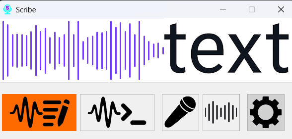

# Scribe

> A powerful, offline, real-time voice-to-text application for Windows.

Scribe is a versatile tool designed to integrate voice commands and transcription seamlessly into your workflow. Powered by the Vosk Offline Speech Recognition Toolkit, it ensures that all your data remains private by processing everything locally on your machine. Whether you need to dictate text, control applications with your voice, or automate repetitive tasks, Scribe provides a flexible and powerful solution.

## Key Features

*   **Real-Time Transcription:** Dictate text directly into any application with high accuracy.
*   **Punctuation and Capitalization:** Automatic `. , ? ! :` and capital letters for Russian and English, with basic sentence capitalization for every other language. Fully offline and enabled by default.
*   **Command Mode:** Execute actions using custom voice commands.
*   **Offline and Private:** All voice processing happens locally on your machine. No data is ever sent to the cloud.
*   **Lightweight Performance:** Low CPU usage, especially when using small Vosk models, ensuring smooth operation without slowing down your system.
*   **Multi-Language Support:** Easily download and switch between different language models.
*   **Customizable Hotkeys:** Configure global hotkeys to start/stop modes and switch between active models.
*   **Text Replacements:** Define custom words or phrases that automatically expand into longer text snippets (e.g., "my email" -> "my.address@example.com").
*   **Voice-Activated Program Launch:** Set up voice commands to open any application or file on your computer.
*   **Flexible Configuration:** Fine-tune input methods (keyboard typing vs. clipboard paste), tray icon appearance, and window behavior to match your preferences.

## Punctuation and Capitalization

Scribe can punctuate dictation on its own: marks and capital letters are added to the final text, entirely on your machine.

*   **Russian and English** use a compact offline neural model (ONNX int8, CPU inference). It inserts `. , ? ! :` and ellipsis, and restores capitalization.
*   **Other languages** get rule-based sentence capitalization: the first word of a sentence is capitalized after `. ! ? ...`.
*   **Pauses are not sentence ends.** Vosk commits text on short pauses; Scribe treats those boundaries as soft and does not insert a period or start a new sentence there. A sentence really ends with `?`, `!`, `...`, an explicit Enter, or a spoken sentence-ending mark.
*   **Lowercase after `,` `:` `;` `—`** for Russian and Ukrainian, while proper nouns keep their capitals.
*   Models download automatically on first run into `models/punct/<language>/` inside the data folder (`%LOCALAPPDATA%\Scribe` for an installed build, the program folder in portable mode) and are never bundled into the executable. If the model is missing or you are offline, Scribe falls back to basic capitalization rules.

The feature is controlled by **Enable punctuation and capitalization** on the **Models** settings page. It is on by default; turn it off to get raw Vosk output. See the [punctuation guide](docs/14_punctuation.md) for details, voice punctuation commands, and troubleshooting.

## Getting Started

### Prerequisites

*   Windows 10 (64-bit) or newer. Windows 7 is not supported by version 1.3.0 and later; see [Troubleshooting and FAQ](docs/13_faq.md).
*   Linux support (version 1.2.0 and later) with X11 graphical interface. Wayland is not currently supported.

### Installation

**Installer (recommended):**

1.  Go to the [**Releases**](https://github.com/AIgrator/Scribe/releases) page.
2.  Download `ScribeSetup.exe` from the "Assets" section.
3.  Run it. Scribe installs per user (no administrator rights) into `%LOCALAPPDATA%\Programs\Scribe` and adds a Start Menu shortcut.

Settings, downloaded models and records are kept in `%LOCALAPPDATA%\Scribe`, so the program folder stays read-only for normal users. The uninstaller removes that folder; it can keep the downloaded voice models if you tick the box.

**Portable:**

1.  Download `Scribe-portable.zip` and unpack it into any folder (or download `Scribe.exe` and create an empty file named `portable.flag` next to it).
2.  Run `Scribe.exe`. All data (settings, models, records, logs) stays in that folder.

Without `portable.flag` the standalone executable also works, but keeps its data in `%LOCALAPPDATA%\Scribe`, exactly like the installed build.

## Building from Source

If you want to build the project from the source code, please follow the instructions in our [**BUILDING.md**](BUILDING.md) file.

## License

This project is licensed under the terms of the [LICENSE](LICENSE) file.

## Acknowledgments

This project relies on the excellent [Vosk Offline Speech Recognition Toolkit](https://alphacephei.com/vosk/).
