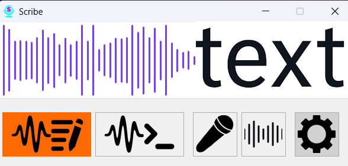

# Section 1: About Scribe

Scribe is your free personal assistant for Windows that transforms your voice into text and commands. It runs in the background, allowing you to dictate text in any application and control your computer without touching the keyboard or mouse.

### Key Features:

*   **Speech-to-Text:** Dictate text in real-time in any text field, with automatic offline punctuation and capitalization for Russian and English, plus smart auto-replacement for frequently used phrases.
*   **Voice Control:** Launch programs, open files, and emulate keyboard shortcuts using custom voice commands.
*   **CPU Optimized:** The program efficiently uses your processor's resources, running quickly without slowing down your system.
*   **Fully Customizable:** Configure hotkeys, performance, text input methods, and the application's appearance, including light and dark themes. Scribe is designed to provide maximum control and customization, allowing you to tailor it to your specific needs.
*   **Privacy-Focused:** Scribe operates entirely offline on your computer. No audio or personal data is ever sent over the internet.

### Speech Recognition Models

For speech recognition, Scribe uses models from the [Vosk project](https://alphacephei.com/vosk/models). This allows for high-quality, offline transcription in multiple languages.

### Important Information

*   **Price and Source Code:** Scribe is a completely free, open-source project. You can review the code and even compile the program yourself.
*   **Compatibility:** The program is compatible with **Windows 10 (64-bit) and newer**. Windows 7 is no longer supported starting with version 1.3.0: offline punctuation and capitalization rely on ONNX Runtime, which requires Windows 10 or later. The last release that runs on Windows 7 is **v1.2.0** (without punctuation support).
*   **Antivirus Warnings (False Positives):** Some antivirus programs may flag Scribe as malicious software (malware). This is a false positive triggered by the application's core features: emulating keystrokes to type text in other windows and launching programs based on user commands. Since Scribe's source code is fully open, anyone can verify its safety.
