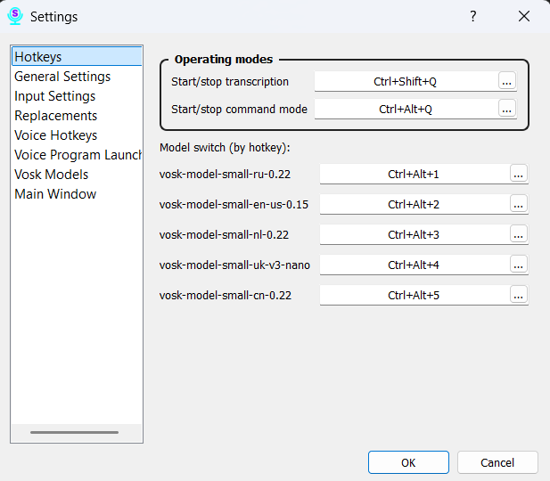

# Section 5: Settings — Hotkeys

This tab allows you to configure global hotkeys to control Scribe's main functions from any application, even when the main window is hidden.

### Main Actions:

*   **Transcription:** Set a key combination to start and stop transcription mode.
*   **Command:** Assign keys to activate the voice command mode.

### Model Management:

*   **Next Model:** This key combination allows you to cycle through all your downloaded speech recognition models.
*   **Hotkeys for Specific Models (Model 1 - Model 9):**
    *   The program automatically assigns hotkeys to the first nine models in your list. Model 1 will correspond to the first model in the list, Model 2 to the second, and so on.
    *   You can customize these combinations as you see fit. If you have more than nine models, you can assign hotkeys to the others manually, but by default, they will only be accessible through the menu or the "Next Model" hotkey.

### How to Change a Hotkey:

1.  Click on the input field next to the action you want to change.
2.  Press the desired key combination on your keyboard.
3.  Click **OK** at the bottom of the window to apply the changes.

### Keyboard Layouts and Reliability

*   **Works in every layout:** A hotkey is stored as the physical key plus its modifiers, not as the character produced by the active keyboard layout. `Ctrl+Alt+0` keeps working after you switch between English, Russian, French and other layouts, and after a reboot. Hotkeys saved by older Scribe versions under a Cyrillic layout (for example `Alt+ю`) are automatically mapped to the same physical key.
*   **The next press is never lost:** Hotkey actions run on a separate thread. Starting or stopping the microphone can take a second, but it no longer blocks the keyboard hook, so a slow action cannot swallow the next press.
*   **Holding a combination** fires it once. Release the keys and press again to trigger it a second time.
*   **If a hotkey does nothing:** another program may already use the combination. Choose a different one, preferably with `Ctrl` or `Alt` and a key that exists in every layout, such as `0`–`9` or `F1`–`F12`.
