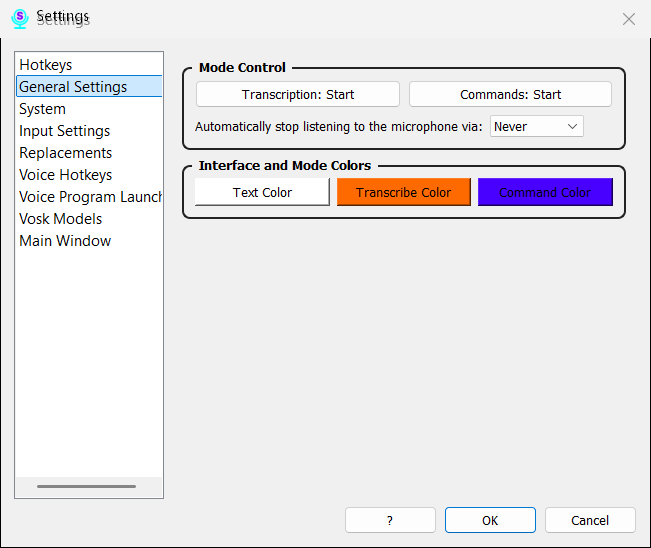
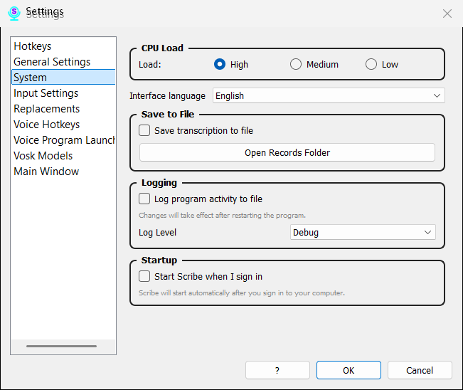

# Section 6: Settings — General and System

The settings window has two tabs for everyday options: **General** and **System**.

## General

This tab contains mode control, auto-stop and colors.

*   **Mode Control Buttons:** Right from this window, you can immediately activate "Transcription" or "Commands" mode. This is useful for quickly testing the program's functionality without returning to the main window. The buttons show the current state and start or stop listening.

*   **Automatically stop listening to the microphone via:** This feature helps save resources and prevent accidental recognition by automatically turning off the microphone after a set period of silence.
    *   **How it works:** A timer starts when listening begins. Every recognized word or phrase resets the timer. If you remain silent for longer than the specified duration, listening will stop. This works for both "Transcription" and "Command" modes.
    *   **Available options:** You can choose from several preset intervals (e.g. 10 seconds, 1 minute) or select "Never" to disable this feature.

*   **Transcription Button Color:** Allows you to choose the color that highlights the button in the main window and the tray icon when transcription mode is active.

*   **Command Button Color:** Similarly, allows you to set a unique color to indicate command-listening mode in the main window and tray.

*   **Tray Font Color:** Here you can select the color for the text displayed in the tray icon's tooltip. This is useful for improving readability against different desktop backgrounds.

## System

This tab contains performance, interface language, file recording, logging and startup options.

*   **CPU Load:** Sets the audio block size used for recognition. Choose **High** for the fastest response (the default, uses more CPU), **Medium** for a balance, or **Low** to reduce processor load on slower computers. Lower load may slightly increase recognition latency.

*   **Interface language:** Here you can change the application's interface language. The new language is applied when you click **OK**.

*   **Save to File:** Tick **Save transcription to file** to save the final transcription results to a text file in the records folder. Use **Open Records Folder** to find them in Explorer.

*   **Logging:** Tick **Log program activity to file** to write a technical log that helps diagnose issues. **Log Level** controls how much detail is written, from **Debug** (maximum detail) to **Critical** (errors only). Changes to logging take effect after restarting Scribe.

*   **Start Scribe when I sign in:** Adds or removes Scribe from the current user's startup list. The installer offers the same option, so this checkbox always shows the real state of the operating system. It works for both the installed and the portable build.

Click **OK** to save your changes. **Cancel** closes the window without saving them.
