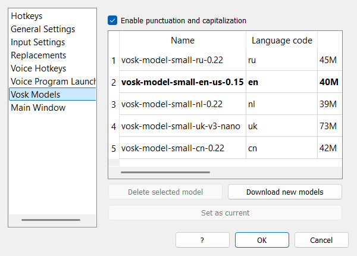

# Section 11: Settings — Vosk Models

This tab is your command center for speech recognition models. Here you can view installed models, set the active one, delete unnecessary ones, and download new ones.

### Punctuation and Capitalization

At the top of the tab there is a checkbox: **Enable punctuation and capitalization**.

*   It is **on by default**, so new installations get punctuated text right away.
*   When it is on, Scribe adds `. , ? ! :` and capital letters to the final recognition result using offline models for **Russian** and **English**, and basic capitalization rules for all other languages.
*   When it is off, you get the raw Vosk transcript, with no automatic marks or case changes.

The matching punctuation model is downloaded automatically on first run into `models/punct/<language>/`. It is not stored inside `Scribe.exe`, and Scribe keeps working without it by falling back to simple capitalization rules.

For a full description of the feature — how pauses are handled, how to dictate punctuation by voice, and what to do if marks do not appear — see [Section 14: Punctuation and Capitalization](./14_punctuation.md).

### List of Installed Models

The main part of the screen is occupied by a table with the models already on your computer. It displays all the key information:
*   **Name:** The official name of the model.
*   **Size:** The model's size on disk.
*   **WER:** (Word Error Rate) — an indicator of the model's accuracy. The lower this value, the more accurate the model.
*   **Description:** Brief information about the model.
*   **License:** The type of license under which the model is distributed.
*   **Language:** The language that this model recognizes.

### Model Management:

*   **Set as Current:** Select a model in the list and click this button to make it active for recognition. The current model is highlighted in the table.

*   **Delete Selected Model:** Select a model and click this button to completely remove it from your computer. Be careful, this action is irreversible.

*   **Download New Models:** Clicking this button will open the familiar window you saw during the initial program setup. In it, you can select and download new models for other languages or more accurate versions for those already installed.
