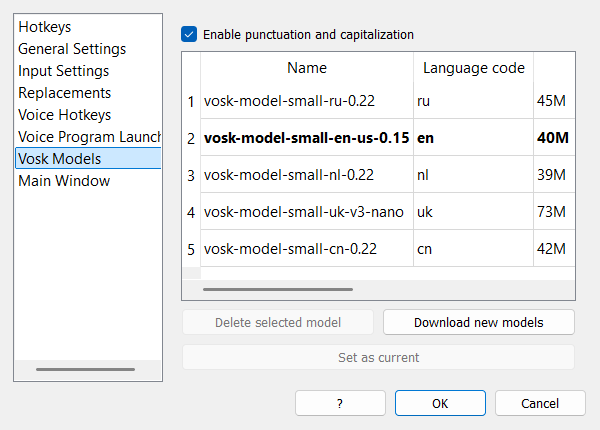

# Section 14: Punctuation and Capitalization

Scribe can turn a stream of plain recognized words into readable text: it adds punctuation marks and capital letters automatically, entirely on your computer. No audio or text is sent anywhere.



### Turning the Feature On and Off

The checkbox **Enable punctuation and capitalization** is located at the top of the **Models** settings tab (see [Section 11](./11_settings_vosk_models.md)).

*   It is **enabled by default** in new installations.
*   When enabled, Scribe processes only the **final** recognition result. Intermediate "draft" text stays raw, so nothing flickers while you speak.
*   When disabled, Scribe inserts what the speech recognition model produced, with no marks and no case changes (your own replacement rules still apply).

### One Model for Every Language

A single multilingual model handles punctuation and capitalization for every recognition language that the model was trained on — 31 of the 32 languages in the Vosk catalog. You do not choose or download a model per language: one file set serves them all.

| What you get | Details |
| --- | --- |
| Automatic marks | `.` `,` `?` `:` and `-` (dash) |
| Capital letters | Sentence starts, names and other words the model recognizes |
| Script-aware marks | Chinese/Japanese `，。？：`, Arabic `، ؟`, Devanagari `।`, Greek `;`, Ethiopic `። ፣` |
| Not automatic | `!` and `...` — insert them with spoken commands (see below) |

The only catalog language without punctuation is **Breton (`br`)**: it is absent from the model's training data, so Scribe uses rules-only mode there.

The feature works fully offline. The model runs on the CPU with ONNX Runtime and is downloaded on demand.

### Context Across Pauses

Vosk finalizes text whenever you pause, even in the middle of a sentence. Scribe treats those boundaries as **soft**:

*   The terminal period that the model adds to a chunk is removed.
*   The first word of a continuation stays lowercase instead of being capitalized.
*   A real sentence ends only with:
    *   `?`, `!` or `...`;
    *   an explicit **Enter** inserted by a replacement rule;
    *   a spoken sentence-ending mark such as "period" or "question mark" (see below).

The model also sees the **previous words you dictated** as context, not just the current chunk. This is what prevents a thinking pause from turning a continuation into a new sentence. The default is the last 30 words; change `punct_context_words` in `settings.json` to use more or fewer (see [Advanced Settings](#advanced-settings)).

For example, if you dictate this with a thinking pause between "делать" and "но":

```
я не знаю что делать  [pause]  но попробую
```

you get one sentence with a question mark where it belongs, and the continuation stays lowercase:

```
Я не знаю, что делать, но попробую.
```

Without the previous-text context, the second chunk would be punctuated in isolation and could become `Что делать? Но попробую.`

### Lowercase After `,` `:` `;` `—`

For Russian and Ukrainian, a word after a comma, colon, semicolon or em dash starts with a lowercase letter, following normal typography. Proper nouns keep their capital letter. This rule is applied after the neural model, so it also fixes occasional model mistakes.

In other languages this rule is not applied: the case after a comma is whatever the model produced.

### Dictating Punctuation by Voice

You can insert marks explicitly with the **Replacements** feature (see [Section 8](./08_settings_replacements.md)). Create rules for the words you want to speak, and use `[Backspace]` to remove the space before the mark.

Typical Russian rules:

| What to replace | What to replace with |
| --- | --- |
| `точка` | `[Backspace].` |
| `запятая` | `[Backspace],` |
| `вопросительный знак` | `[Backspace]?` |
| `восклицательный знак` | `[Backspace]!` |
| `многоточие` | `[Backspace]...` |
| `новая строка` | `[Backspace][Enter]` |

Typical English rules:

| What to replace | What to replace with |
| --- | --- |
| `period` | `[Backspace].` |
| `comma` | `[Backspace],` |
| `question mark` | `[Backspace]?` |
| `exclamation mark` | `[Backspace]!` |
| `ellipsis` | `[Backspace]...` |
| `new line` | `[Backspace][Enter]` |

Spoken marks take priority over the automatic ones: if the model already added a comma and you then say "period", Scribe removes the comma and leaves a single period. An Enter starts a new sentence, so the next word is capitalized.

### Model Files

The punctuation model lives in one folder inside the data folder (`%LOCALAPPDATA%\Scribe`, or the program folder in portable mode):

```
models/
└── punct/
    └── multi/                Multilingual model (all supported languages)
        ├── model.int8.onnx
        ├── tokenizer.json
        └── config.json
```

*   The model is **not bundled** into `Scribe.exe`; it is downloaded automatically on first run.
*   It is `Horizon-Labs/multilingual-punctuation-truecase-small` (Apache-2.0), exported to int8 ONNX. The ONNX file is about 268 MB and the tokenizer about 34 MB.
*   The catalog of downloadable files is [`punct_models.json`](https://github.com/AIgrator/Scribe/blob/main/punct_models.json).
*   If the download fails or you are offline, Scribe continues to work in rules-only mode: sentence capitalization still works, but automatic commas and question marks are not added.

To force a fresh download of the model, close Scribe, delete the `models/punct/multi` folder from the data folder, and start the program again.

### Advanced Settings

The feature has no extra controls in the interface, but a few values can be changed in `settings.json` (in the data folder: `%LOCALAPPDATA%\Scribe\settings.json`):

| Key | Default | Meaning |
| --- | --- | --- |
| `enable_punctuation` | `true` | Same as the checkbox on the Models page |
| `punct_confidence` | `0.5` | Minimum probability for a mark. Raise it for fewer, more reliable marks; `0.0` accepts the model's best guess |
| `punct_context_words` | `30` | How many previous words are fed to the model as context |
| `punctuation_model_dir` | `""` | Custom model folder; empty means `models/punct/multi` |

Close Scribe before editing the file. Delete `settings.json` from the data folder to return to the defaults.

### Troubleshooting

**No punctuation appears.**
Check that **Enable punctuation and capitalization** is on and that the recognition language is not Breton. Make sure `models/punct/multi/` exists in the data folder and is not empty; if not, restart Scribe while online.

**Marks appear, but too rarely or too often.**
Adjust `punct_confidence` in `settings.json`: a higher value (for example `0.6`) removes uncertain marks, a lower value (`0.3`) adds more.

**A pause still breaks the sentence.**
The soft-boundary behavior removes only a lone terminal period. A question mark, exclamation mark or ellipsis is treated as a real sentence end, and a spoken punctuation command or Enter also starts a new sentence by design. Increase `punct_context_words` if the model still loses the thread after a pause.

**A name lost its capital letter after a pause.**
The model restores most capitalization, but a name at the start of a continuation can occasionally be lowercased. Capitalize it manually, or turn the feature off for that dictation.

**The model is still the old per-language one.**
Earlier versions stored Russian and English models in `models/punct/ru` and `models/punct/en`. Those folders are ignored now. Delete them to reclaim space, then restart Scribe to download the multilingual model.
