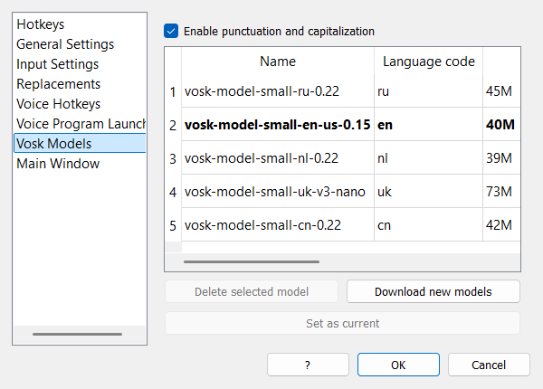

# Section 14: Punctuation and Capitalization

Scribe can turn a stream of plain recognized words into readable text: it adds punctuation marks and capital letters automatically, entirely on your computer. No audio or text is sent anywhere.



### Turning the Feature On and Off

The checkbox **Enable punctuation and capitalization** is located at the top of the **Models** settings tab (see [Section 11](./11_settings_vosk_models.md)).

*   It is **enabled by default** in new installations.
*   When enabled, Scribe processes only the **final** recognition result. Intermediate "draft" text stays raw, so nothing flickers while you speak.
*   When disabled, Scribe inserts what the speech recognition model produced, with no marks and no case changes (your own replacement rules still apply).

### What Each Language Gets

| Language | Automatic marks | Capitalization |
| --- | --- | --- |
| Russian (`ru`) | Offline neural model: `.` `,` `?` `!` `:` `...` | Sentence starts and proper nouns (via morphology dictionaries) |
| English (`en`) | Offline neural model: `.` `,` `?` `!` `:` `...` | Sentence starts and most capitalization |
| Ukrainian (`uk`) | None (spoken commands only) | Sentence starts; proper nouns shared with the Russian dictionary |
| All other languages | None (spoken commands only) | Sentence starts: first word after `.` `!` `?` `...` |

The feature works fully offline. The neural models run on the CPU with ONNX Runtime and are downloaded on demand.

### Pauses Are Not Sentence Ends

Vosk finalizes text whenever you pause, even in the middle of a sentence. Scribe treats those boundaries as **soft**:

*   The terminal period that the punctuation model adds to every chunk is removed.
*   The first word of a continuation stays lowercase instead of being capitalized.
*   A real sentence ends only with:
    *   `?`, `!` or `...`;
    *   an explicit **Enter** inserted by a replacement rule;
    *   a spoken sentence-ending mark such as "period" or "question mark" (see below).

For example, if you dictate this with a thinking pause between "погода" and "и":

```
сегодня хорошая погода  [pause]  и мы пойдём гулять
```

you get one sentence:

```
Сегодня хорошая погода и мы пойдём гулять.
```

Without soft boundaries the same dictation used to become two sentences: `Сегодня хорошая погода. И мы пойдём гулять.`

### Lowercase After `,` `:` `;` `—`

For Russian and Ukrainian, a word after a comma, colon, semicolon or em dash starts with a lowercase letter, following normal typography. Proper nouns keep their capital letter. This rule is applied after the neural model, so it also fixes occasional model mistakes.

In English this rule is not applied: the case after a comma is whatever the model produced.

### Dictating Punctuation by Voice

You can insert marks explicitly with the **Replacements** feature (see [Section 8](./08_settings_replacements.md)). Create rules for the words you want to speak, and use `[Backspace]` to remove the space before the mark.

Typical Russian rules:

| What to replace | What to replace with |
| --- | --- |
| `точка` | `[Backspace].` |
| `запятая` | `[Backspace],` |
| `вопросительный знак` | `[Backspace]?` |
| `восклицательный знак` | `[Backspace]!` |
| `новая строка` | `[Backspace][Enter]` |

Typical English rules:

| What to replace | What to replace with |
| --- | --- |
| `period` | `[Backspace].` |
| `comma` | `[Backspace],` |
| `question mark` | `[Backspace]?` |
| `exclamation mark` | `[Backspace]!` |
| `new line` | `[Backspace][Enter]` |

Spoken marks take priority over the automatic ones: if the model already added a comma and you then say "period", Scribe removes the comma and leaves a single period. An Enter starts a new sentence, so the next word is capitalized.

### Model Files

Punctuation models live in the `models/punct/` folder next to the program:

```
models/
└── punct/
    ├── ru/                  Russian model
    │   ├── model.int8.onnx
    │   ├── tokenizer.json
    │   └── model.json
    └── en/                  English model
        ├── model.int8.onnx
        ├── tokenizer.json
        └── model.json
```

*   The models are **not bundled** into `Scribe.exe`; they are downloaded automatically on first run for the selected recognition language.
*   The Russian model is **RUPunct_big int8** (about 170 MB). The English model is an export of `felflare/bert-restore-punctuation` int8 (about 105 MB). Both are MIT-licensed and hosted on Hugging Face under [AIgrator](https://huggingface.co/AIgrator).
*   The catalog of downloadable files is [`punct_models.json`](https://github.com/AIgrator/Scribe/blob/main/punct_models.json).
*   If the download fails or you are offline, Scribe continues to work in rules-only mode: sentence capitalization still works, but automatic commas and question marks are not added.

To force a fresh download of a model, close Scribe, delete its folder (for example `models/punct/ru`), and start the program again.

### Advanced Settings

The feature has no extra controls in the interface, but a few values can be changed in `settings.json`:

| Key | Default | Meaning |
| --- | --- | --- |
| `enable_punctuation` | `true` | Same as the checkbox on the Models page |
| `punct_confidence` | `0.5` | Minimum probability for a mark. Raise it for fewer, more reliable marks; `0.0` accepts the model's best guess |
| `punct_context_words` | `30` | How many previous words are fed to the model as context |
| `punctuation_model_dir` | `""` | Custom model folder; empty means `models/punct/<language>` |

Close Scribe before editing the file. Delete `settings.json` to return to the defaults.

### Troubleshooting

**No punctuation appears.**
Check that **Enable punctuation and capitalization** is on, and that the correct recognition language is selected. For Russian and English, make sure the model folder exists in `models/punct/` and is not empty; if not, restart Scribe while online.

**Marks appear, but too rarely or too often.**
Adjust `punct_confidence` in `settings.json`: a higher value (for example `0.6`) removes uncertain marks, a lower value (`0.3`) adds more.

**A pause still breaks the sentence.**
The soft-boundary behavior removes only a lone terminal period. A question mark, exclamation mark or ellipsis is treated as a real sentence end, and a spoken punctuation command or Enter also starts a new sentence by design.

**An English name lost its capital letter after a pause.**
English proper-noun detection relies on Russian/Ukrainian morphology dictionaries, so a name at the start of a continuation can occasionally be lowercased. Capitalize it manually, or turn the feature off for that dictation.

**The Russian model is still the old, smaller one.**
The model is only downloaded when the folder is missing. Delete `models/punct/ru` once and restart Scribe to download RUPunct_big.
